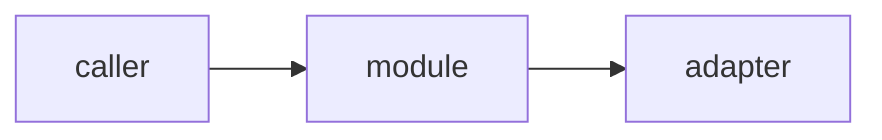

# <Title> — architecture

> Ticket: `<YYYY-MM-DD-HHmm>_<slug>` · Requirements: [feature.md](./feature.md)

## Overview

<The shape of the change in a few sentences, and a diagram when it helps.>

## Structure

<Files and modules added or changed, per workspace. Mark new files.>

## Contracts

<Interfaces, routes, messages and data shapes that other code or tests depend on, as sketches.>

## Seams

<The public interfaces tests observe behaviour through. `tdd` writes tests only at these seams.>

| Seam | Catches | Misses |
|---|---|---|
| `<module or route>` | <behaviour a test here proves> | <what it cannot see> |

## Decisions

<One entry per choice that is hard to reverse, surprising without context, and a real trade-off.
Each line of an entry is one or two sentences; a rejected alternative is kept only when someone
would propose it again.>

- **D1 — <the decision, in one line>.**
  - **Why:** <the reason>.
  - **Cost accepted:** <what this choice makes worse>.
  - **Reversal:** <one commit | a migration | irreversible: …>.
  - **Rejected:**
    - <alternative> — <why not>.

## Risks

<One entry per risk, in the order: what could go wrong → what it would cause → how the plan
contains it.>

- **<Risk, in one line>.** <What it would cause.> *Contained by:* <step, check or test>.
