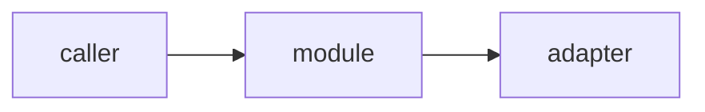

# <Title> — architecture

> Ticket: `<YYYY-MM-DD>_<slug>` · Requirements: [feature.md](./feature.md)

## Overview

<The shape of the change in a few sentences, and a diagram when it helps.>

## Structure

<Files and modules added or changed, per workspace. Mark new files.>

## Contracts

<Interfaces, routes, messages and data shapes that other code or tests depend on, as sketches.>

## Seams

<The public interfaces tests observe behaviour through. `tdd` writes tests only at these seams.>

| Seam | Catches | Misses |
|---|---|---|
| `<module or route>` | <behaviour a test here proves> | <what it cannot see> |

## Decisions

<One entry per choice that is hard to reverse, surprising without context, and a real trade-off.>

- **D1 — <decision>.** <Why.> *Rejected:* <alternative and why not>.

## Risks

| Risk | Mitigation |
|---|---|
| <what could go wrong> | <how the plan contains it> |
