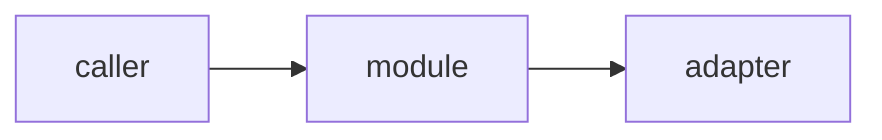

# <Title> — architecture

> Ticket: `<YYYY-MM-DD-HHmm>_<slug>` · Requirements: [feature.md](./feature.md)

## Overview

<The shape of the change in a few sentences, and a diagram when it helps.>

## Structure

<Where the change lives, per workspace: the modules it adds or changes and the invariant each
keeps. It names modules and workspaces; the plan's steps hold files and signatures. A rule a
config holds is linked, never copied.>

## Contracts

<Interfaces, routes, messages and data shapes between modules and between steps that other code
or tests depend on; it sketches the shape of each contract, and the step that builds it writes
the signatures.>

## Seams

<The public interfaces tests observe behaviour through. `tdd` writes tests only at these seams.>

| Seam | Catches | Misses |
|---|---|---|
| `<module or route>` | <behaviour a test here proves> | <what it cannot see> |

## Decisions

<One entry per choice that is hard to reverse, surprising without context, and a real trade-off.
Each line of an entry is one or two sentences; each entry keeps at least one rejected
alternative, the one someone would propose again.>

- **D1 — <the decision and the invariant it keeps, in one line>.**
  - **Why:** <the reason>.
  - **Cost accepted:** <what this choice makes worse>.
  - **Reversal:** <one commit | a migration | irreversible: …>.
  - **Rejected:**
    - <alternative> — <why not>.

## Direction

<One recommendation per choice a stage can still make or undo, shown to the user as written; the
stage design takes it or sets it aside, with the fact.>

- **<area>** — recommend <option>, over <option>: <why>. Settled in Stage <n>.

## Assumptions

<One entry per fact the design takes as true unchecked; the preparation of the stage it names
checks it before that stage's design.>

- **A1 — <what the design takes as true>.** Checked in Stage <n>, by <a read | a probe>.
  If false: <the Seam, Contract or D… it changes>.

## Risks

<One entry per risk, in the order: what could go wrong → what it would cause → how the plan
contains it.>

- **<Risk, in one line>.** <What it would cause.> *Contained by:* <step, check or test>.
